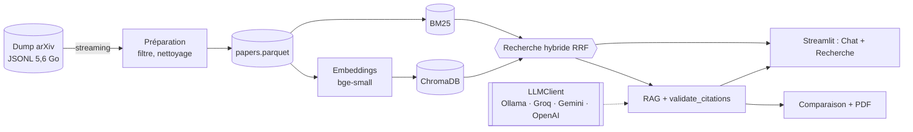

# Research Paper Explorer

**Assistant de recherche bibliographique fondé sur l'IA générative** — projet du module
*Generative AI* (ENSIAS).

Research Paper Explorer aide un étudiant ou un chercheur à explorer la littérature
scientifique en informatique (catégorie arXiv `cs.CL`). On lui pose une question en langage
naturel. Il retrouve les papiers pertinents, rédige une réponse dont **chaque affirmation cite
un papier arXiv réel et vérifié**, puis compare les papiers cités et peut produire un rapport
PDF.

Source de données : le [dataset arXiv de Kaggle](https://www.kaggle.com/datasets/Cornell-University/arxiv)
(Cornell University, environ 5,6 Go). Il est complété par l'API arXiv (veille) et par les PDF
d'arxiv.org.

---

## Fonctionnalités

| Fonctionnalité | Description |
|---|---|
| **Chat RAG** | Réponses en français ou en anglais, sur tout le corpus ou sur un papier, avec citations `[arXiv:ID]` cliquables. Si le contexte ne suffit pas, la réponse est « Je ne sais pas » plutôt qu'une invention. |
| **Historique des conversations** | Chaque conversation est enregistrée. On peut en démarrer une nouvelle, reprendre n'importe laquelle, la télécharger en Markdown ou la supprimer. |
| **Comparaison des papiers cités** | Tableau méthode / datasets / résultats / limitations / pertinence, synthèse comparative, export Markdown ou CSV. |
| **Rapport PDF** | Réponse, fiche de chaque papier, tableau comparatif et références, en un clic. |
| **Recherche hybride** | BM25 + embeddings sémantiques fusionnés par RRF, avec filtres (années, catégories, venue, code, accepté). Chaque résultat peut être envoyé au Chat. |
| **Texte intégral** | Les PDF arXiv téléchargés sont découpés par section. Le RAG sur un papier cite alors la section (`[arXiv:ID §Method]`) et la comparaison utilise le texte complet. |

### Garanties contre les hallucinations
- `validate_citations()` retire tout identifiant arXiv ou toute section qui n'apparaît pas
  dans les documents réellement récupérés.
- Les sections *Références* sont produites par le code, jamais par le LLM.
- Une information absente du texte devient « Non mentionné » au lieu d'être devinée.
- Les sorties structurées du LLM sont validées par Pydantic et corrigées automatiquement si
  besoin.

---

## Architecture



Le pipeline et la communication entre les composants sont détaillés dans le rapport
[docs/rapport_projet.pdf](docs/rapport_projet.pdf).

**Technologies** : Python 3.12, orjson, pandas/pyarrow, sentence-transformers, ChromaDB,
rank-bm25, client OpenAI (Ollama en local), Pydantic, PyMuPDF, ReportLab, Streamlit, Typer,
pytest, ruff.

---

## Installation

Prérequis : **Python 3.11 ou plus** et environ 8 Go de RAM. Pour un LLM local, installer
[Ollama](https://ollama.com).

```powershell
git clone https://github.com/Sabbarso/agent-ai-.git
cd agent-ai-
py -3.12 -m venv .venv
.venv\Scripts\activate              # Linux / macOS : source .venv/bin/activate
pip install -r requirements.txt
pip install -e . --no-deps
```

### Configuration du LLM

Copier `.env.example` en `.env`, puis choisir un fournisseur. Le fichier `.env` n'est jamais
commité.

```ini
# Option locale et gratuite (Ollama) : ollama pull qwen2.5:3b
LLM_BASE_URL=http://localhost:11434/v1
LLM_API_KEY=ollama
LLM_MODEL=qwen2.5:3b
EMBEDDING_MODEL=BAAI/bge-small-en-v1.5
```

| Fournisseur | `LLM_BASE_URL` | Exemple de `LLM_MODEL` |
|---|---|---|
| Ollama (local) | `http://localhost:11434/v1` | `qwen2.5:3b` |
| Groq | `https://api.groq.com/openai/v1` | `llama-3.3-70b-versatile` |
| Gemini | `https://generativelanguage.googleapis.com/v1beta/openai/` | `gemini-2.0-flash` |
| OpenAI | `https://api.openai.com/v1` | `gpt-4o-mini` |

Les autres paramètres (catégories, dates, tailles, seuils) sont dans
[config.yaml](config.yaml).

### Données

Télécharger `arxiv-metadata-oai-snapshot.json` depuis Kaggle et le placer dans
`data/raw/`. Le fichier est lu ligne par ligne : il n'est jamais chargé entièrement en
mémoire.

---

## Lancement

### 1. Construire le corpus et les index (une seule fois)

```powershell
python -m rpe.cli prepare-data      # filtre et nettoie le dump -> data/processed/papers.parquet
python -m rpe.cli build-index       # embeddings + ChromaDB + BM25 -> data/index/
```

Pour un essai rapide sur 1 000 papiers, ajouter `--dev` aux deux commandes. Les étapes sont
reprenables : si elles sont interrompues, une nouvelle exécution repart de là où elle
s'était arrêtée.

### 2. Lancer l'application

```powershell
streamlit run app/streamlit_app.py
```

Ouvrir **http://localhost:8501**. L'application s'ouvre sur le **Chat** :

1. Poser une question, par exemple *How can retrieval reduce hallucinations in LLMs?*
2. Lire la réponse citée, puis la comparaison des papiers cités. *Générer le rapport PDF*
   produit le rapport.
3. La barre latérale liste l'historique : *Nouvelle conversation*, reprise d'une ancienne
   conversation, téléchargement ou suppression.
4. La page **Recherche** permet de filtrer le corpus. *Interroger avec le RAG* ouvre le Chat
   sur le papier choisi.

Sur la page Chat, le menu *Options* permet de choisir la portée (corpus ou un papier), la
langue de réponse et l'affichage de la comparaison.

### 3. Optionnel : texte intégral des PDF

```powershell
python -m rpe.cli fetch-pdfs        # télécharge jusqu'à 300 PDF depuis arxiv.org (3 s entre requêtes)
python -m rpe.cli index-pdfs        # découpe par section et indexe les passages
```

### Ligne de commande

| Commande | Rôle |
|---|---|
| `python -m rpe.cli prepare-data [--dev]` | préparation du corpus |
| `python -m rpe.cli build-index [--dev]` | construction des index |
| `python -m rpe.cli search "query" --year-min 2024 --has-code` | recherche hybride filtrée |
| `python -m rpe.cli ask "question" --lang fr --pdf rapport.pdf` | réponse RAG citée et rapport PDF |
| `python -m rpe.cli fetch-pdfs` puis `index-pdfs` | texte intégral des PDF |

`python -m rpe.cli --help` liste les commandes. Le script `scripts/demo.ps1` (ou
`scripts/demo.sh`) enchaîne une démonstration complète sur 1 000 papiers, puis lance
l'application.

---

## Structure du dépôt

```
app/                    application Streamlit (chat.py, search.py)
src/rpe/
  data/                 lecture streaming, nettoyage, enrichissement
  index/                embeddings, ChromaDB, BM25, recherche hybride
  llm/                  client LLM, prompts, schémas Pydantic
  rag/                  RAG, citations, comparaison, fiche de lecture
  reports/              rapports PDF (ReportLab)
  pdf/                  téléchargement et découpage des PDF arXiv
  ui/                   composants d'interface, historique des conversations
  resources.py          chargement partagé des index et du LLM
  cli.py                ligne de commande
tests/                  113 tests automatisés (LLM simulé, sans réseau)
scripts/                démo et génération des documents
docs/                   rapport de projet et exemple de rapport PDF
assets/fonts/           police DejaVuSans (licence incluse)
config.yaml, .env.example
```

## Tests et qualité

```powershell
pytest                  # 113 tests
ruff check .            # qualité du code
```


## Limites

- Un LLM local de 3B sur CPU répond en 1 à 4 minutes. Un fournisseur hébergé (Groq, Gemini)
  est beaucoup plus rapide, sans changer le code.
- L'enrichissement des venues ne couvre que les conférences et revues listées.
- Les jeux d'évaluation sont générés en brouillon et doivent être validés à la main.
