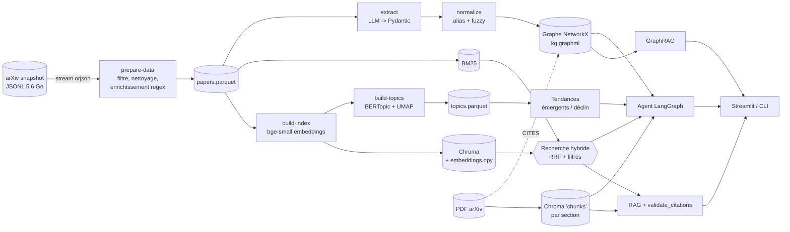
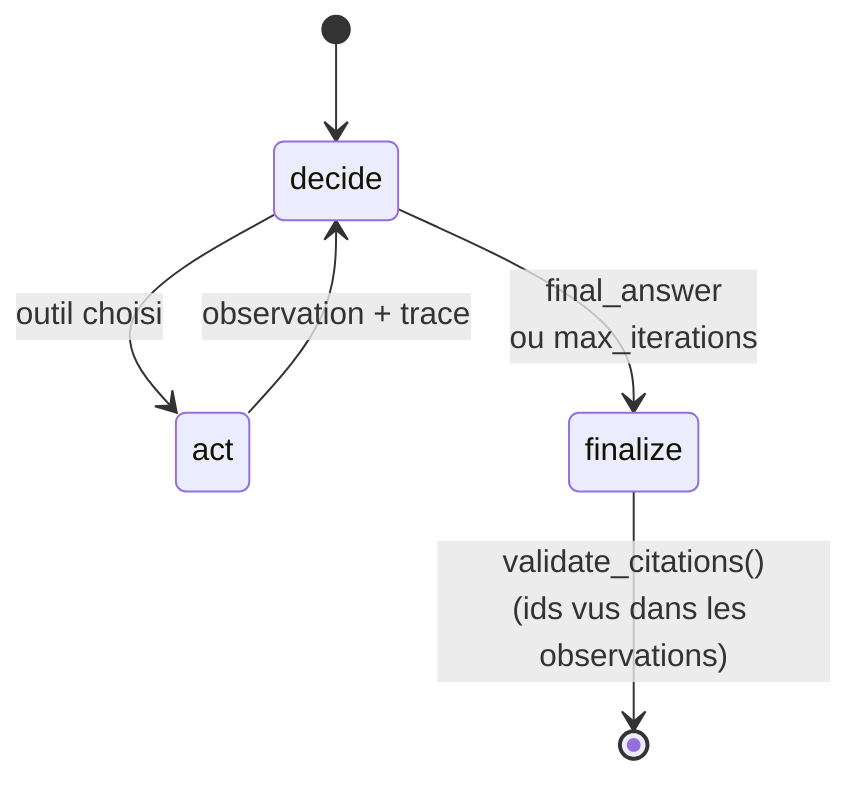
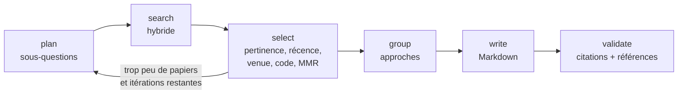

# Research Paper Explorer

Plateforme d'IA générative pour explorer la littérature scientifique en informatique
(projet Generative AI, ENSIAS). Elle combine :

- une **recherche hybride** (BM25 + embeddings denses, fusion RRF, filtres) ;
- un **RAG avec citations vérifiées** : chaque `[arXiv:ID]` doit appartenir au contexte récupéré ;
- un **graphe de connaissances** construit par extraction LLM (tâches, méthodes, datasets,
  métriques) et interrogé en **GraphRAG** ;
- l'**analyse de tendances** (BERTopic, carte UMAP, sujets émergents ou en déclin) ;
- un **agent LangGraph** : état de l'art, research gaps, veille arXiv, recommandation,
  fiche de lecture.

Le cahier des charges est dans [AGENTS.md](AGENTS.md) et les prompts de phases dans
[PROMPTS_CODEX.md](PROMPTS_CODEX.md).

Source de données unique : le [dataset arXiv de Kaggle](https://www.kaggle.com/datasets/Cornell-University/arxiv)
(`arxiv-metadata-oai-snapshot.json`, environ 5,6 Go, JSON Lines). Il est complété par l'API
arXiv pour la veille et par `arxiv.org/pdf` pour quelques centaines de PDF.

## Architecture



**Agent ReAct** (`rpe.agent.graph`) : le LLM choisit un outil ou répond, sa décision est un
JSON validé par Pydantic. L'agent fonctionne donc avec tout fournisseur compatible OpenAI,
même sans *tool calling* natif.



Outils : `search_papers`, `get_paper`, `graph_query`, `recommend_similar`, `get_trends`,
`find_research_gaps`, `read_pdf`, `fetch_latest_arxiv`.

**État de l'art** (`rpe.agent.sota`, workflow LangGraph) :



### Garde-fous anti-hallucination

- `validate_citations()` ([citations.py](src/rpe/rag/citations.py)) retire, ou signale avec
  `mode="flag"`, tout `[arXiv:ID]` absent du contexte, ainsi que les `§Section` inventées.
- RAG : si le contexte est insuffisant, ou si aucune citation valide ne subsiste, la réponse
  est « I don't know » / « Je ne sais pas ».
- Section *References* de l'état de l'art : elle est générée par le code à partir des seuls
  IDs validés, jamais par le LLM.
- Tendances : le LLM ne reçoit que des chiffres calculés, et tout nombre de sa synthèse
  absent des données est signalé (`unknown_numbers`).
- Research gaps : formulés comme des **hypothèses**, avec les papiers proches en preuve.

## Installation

```bash
py -3.12 -m venv .venv               # Python >= 3.11 (testé avec 3.12)
.venv\Scripts\activate               # Linux/macOS : source .venv/bin/activate
pip install -r requirements.txt
pip install -e . --no-deps
```

Placer le dump Kaggle dans `data/raw/arxiv-metadata-oai-snapshot.json`. Il n'est jamais
téléchargé automatiquement et jamais chargé entièrement en mémoire.

Dépendances ajoutées à la stack, avec leur justification :
- `pyyaml` : lecture de `config.yaml` ;
- `openai` : client compatible OpenAI pour `LLMClient` ;
- `httpx` : téléchargement des PDF ; il est déjà installé avec `openai`.

`neo4j` n'est pas requis : `Neo4jGraphStore` est optionnel.

## Configuration

- [config.yaml](config.yaml) : catégories, dates, tailles d'échantillon, chemins,
  hyperparamètres (retrieval, topics, tendances, graphe, agent, PDF).
- `.env`, à copier depuis [.env.example](.env.example) et jamais commité :

| Fournisseur | `LLM_BASE_URL` | `LLM_MODEL` (exemple) |
|---|---|---|
| Ollama (local) | `http://localhost:11434/v1` | `qwen2.5:3b`, `llama3` |
| Groq | `https://api.groq.com/openai/v1` | `llama-3.3-70b-versatile` |
| Gemini | `https://generativelanguage.googleapis.com/v1beta/openai/` | `gemini-2.0-flash` |
| OpenAI | `https://api.openai.com/v1` | `gpt-4o-mini` |

Tous les appels LLM ont un timeout, des retries exponentiels, un cache disque par hash
d'entrée (`data/cache/llm/`) et un compteur d'appels, affiché en fin de commande.

## Commandes (dans l'ordre)

Ajouter `--dev` à n'importe quelle commande pour travailler sur 1 000 papiers. Les
artefacts dev sont séparés : `*_dev.parquet`, `data/index_dev/`, etc. Toutes les étapes
longues sont **reprenables** : elles sautent ce qui existe déjà, et `--force` reconstruit.

| Phase | Commande | Sortie |
|---|---|---|
| 1 | `python -m rpe.cli prepare-data` | `data/processed/papers.parquet` + statistiques |
| 2 | `python -m rpe.cli build-index` | `data/index/` (embeddings.npy, Chroma, bm25.pkl) |
| 2 | `python -m rpe.cli search "query" --year-min 2024 --has-code` | résultats classés |
| 3 | `python -m rpe.cli ask "question" [--paper ID] [--lang fr]` | réponse citée |
| 3 | `python -m rpe.cli reading-sheet 2310.xxxxx --lang fr [-o fiche.md]` | fiche de lecture |
| 4 | `python -m rpe.cli build-topics [--no-llm]` | topics.parquet, topic_map.html |
| 4 | `python -m rpe.cli trends [--topic "agents"]` | émergents / déclin + synthèse |
| 5 | `python -m rpe.cli extract [--limit N]` | extractions.jsonl (cache) |
| 5 | `python -m rpe.cli build-graph` | `data/graph/kg.graphml` (+ .pkl) |
| 5 | `python -m rpe.cli graph-ask "Which papers use SQuAD?"` | réponse GraphRAG |
| 5 | `python -m rpe.cli graph-stats` | auteurs centraux, communautés |
| 6 | `python -m rpe.cli agent "question"` | trace + réponse |
| 6 | `python -m rpe.cli sota "retrieval-augmented generation" -o sota.md` | revue Markdown |
| 6 | `python -m rpe.cli gaps [--task "machine translation"]` | gaps (hypothèses) |
| 6 | `python -m rpe.cli recommend ID1 ID2 ID3` | recommandations expliquées |
| 6 | `python -m rpe.cli digest --query "LLM agents" --days 1` | `data/digests/*.md` |
| 7 | `python -m rpe.cli fetch-pdfs` puis `index-pdfs` | PDF, chunks, arêtes CITES |
| 8 | `streamlit run app/streamlit_app.py` | interface web |
| 9 | `python -m rpe.cli make-eval-sets` puis `evaluate --all` | `eval/report.md` |

Démo complète en mode dev : `bash scripts/demo.sh`, ou sous Windows
`powershell -ExecutionPolicy Bypass -File scripts\demo.ps1`.

## Interface (Streamlit)

L'interface est volontairement réduite à la **recherche** et au **RAG**, avec des icônes
Material :
- **Recherche** : requête, mode (hybride, BM25, dense) et filtres (années, catégories,
  venue, code, accepté). Chaque résultat propose « Interroger avec le RAG », qui ouvre le
  Chat sur ce papier, et un TL;DR. « Poser cette requête au RAG » envoie la requête au RAG
  sur tout le corpus.
- **Chat (RAG)** : portée corpus ou un papier, réponses avec citations `[arXiv:ID]`
  cliquables et contexte récupéré.

- **Comparaison des papiers cités** (sous chaque réponse, interrupteur « Afficher la
  comparaison ») : tableau, onglets Méthodes / Datasets & métriques / Résultats / Limitations,
  synthèse comparative, export Markdown / CSV.
- **Rapport PDF** (option) : le bouton « Générer le rapport PDF » produit un PDF avec page de
  titre, réponse avec citations cliquables, fiche par papier, tableau comparatif en paysage,
  synthèse et références. Il réutilise la comparaison déjà affichée (pas de nouvel appel LLM).
  Même rapport en CLI : `python -m rpe.cli ask "question" --pdf rapport.pdf`. Pour l'état
  de l'art : `python -m rpe.cli sota "topic" --pdf sota.pdf`. Exemple :
  [tests/output/sample_report.pdf](tests/output/sample_report.pdf)
  (`python scripts/make_sample_report.py`). Police DejaVuSans dans
  [assets/fonts/](assets/fonts/) (licence incluse).

Les autres fonctionnalités (tendances, graphe, gaps, état de l'art, veille, fiche de
lecture) restent disponibles en CLI. Les index sont chargés une seule fois
(`st.cache_resource`). Si un artefact manque, la page affiche la commande à lancer. Tant
que l'index complet n'est pas construit, l'interface démarre en mode `--dev` (interrupteur
dans la barre latérale).

Captures d'écran : voir [docs/screenshots/](docs/screenshots/).

## Évaluation

`make-eval-sets` produit des brouillons semi-automatiques à **valider à la main** :
- `queries.jsonl` : 30 requêtes *known-item*, à compléter avec d'autres papiers pertinents ;
- `extraction_gold_todo.jsonl` : 50 résumés pré-annotés par le LLM. Après correction, mettre
  `"validated": true` et enregistrer sous `extraction_gold.jsonl`. Une pré-annotation LLM
  n'est jamais utilisée comme gold ;
- `rag_questions.jsonl` : 20 questions.

`evaluate --all` calcule :
- retrieval : Recall@5/10, MRR et nDCG@10 pour BM25, dense et hybride ;
- extraction : P/R/F1 par champ après normalisation ;
- RAG : taux de citations valides, fidélité et pertinence (LLM juge, prompt strict).

Les résultats sont écrits dans [eval/report.md](eval/report.md).

## Tests et qualité

```bash
pytest                       # tests unitaires, LLM mocké, sans réseau
ruff check . && ruff format --check .
```

## Limites

- L'enrichissement par regex ne couvre que les venues listées. Les autres (FAccT, WMT…)
  ont `venue = null`, mais `is_accepted` reste détecté.
- L'extraction et les étiquettes de topics dépendent fortement du LLM. Un petit modèle
  local (3B) est lent sur CPU et moins précis qu'un modèle hébergé.
- Les gaps reposent sur des co-occurrences dans un échantillon : ce sont des hypothèses à
  vérifier, pas des certitudes.
- Le découpage des PDF en sections est heuristique (titres usuels).
- L'évaluation retrieval est *known-item* tant que les relevances ne sont pas annotées.

## Pistes d'amélioration

- Re-ranking par cross-encoder après la fusion RRF.
- Normalisation des entités par embeddings en plus de la similarité de chaînes.
- Neo4j pour des requêtes Cypher multi-sauts sur le graphe complet.
- Évaluation RAGAS et juge LLM distinct du générateur.
- Mise à jour incrémentale (nouveaux papiers de l'API) des index et du graphe.
